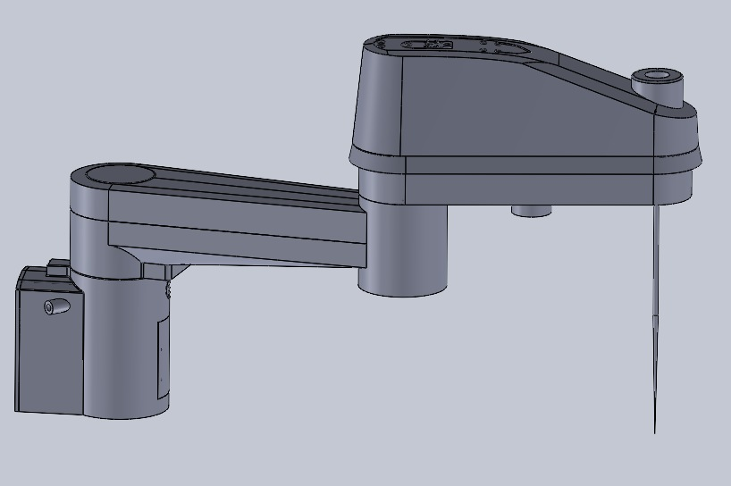
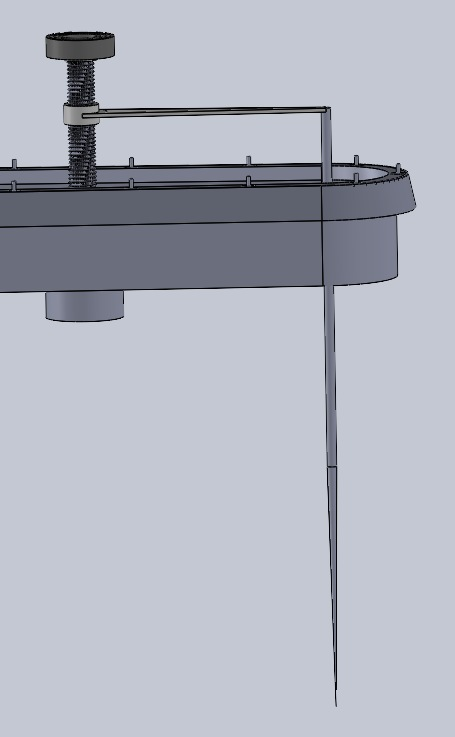
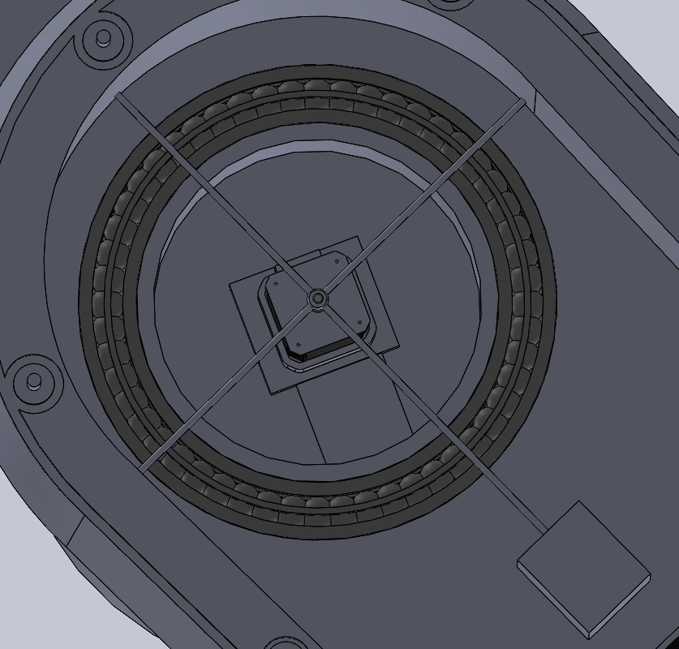
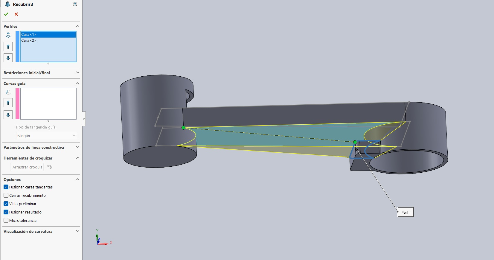
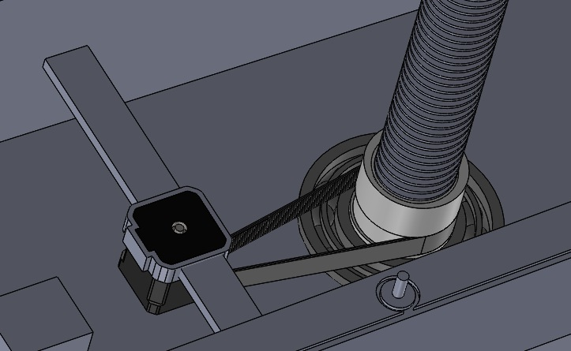

# SCARA Robot — Mechanical Design and CAD Assembly

**Academic Engineering Project | Universidad Europea de Madrid | 2025–2026**

## Project Overview

Mechanical design and CAD assembly of a SCARA-type robotic manipulator inspired by the ABB IRB 930 industrial robot.

The project focused on developing the mechanical structure, joints, transmission elements and vertical tool mechanism of a four-axis SCARA architecture.

The proposed end effector uses a needle-like tool intended for piercing operations.

The robot was developed as a digital CAD model. The project did not include fabrication of a complete physical prototype.

## Reference Robot

The ABB IRB 930 was selected as a reference for the mechanical architecture.

SCARA robots are especially suitable for repetitive industrial tasks requiring horizontal positioning and vertical tool movement.

The academic design adapted the general structure of the reference robot while introducing simplified and custom-designed mechanical solutions.

The objective was not to reproduce the original ABB robot exactly, but to explore the engineering challenges involved in designing a robotic mechanism.

## Technologies and Engineering Methods

- SolidWorks
- Parametric 3D CAD modeling
- Mechanical assembly design
- Geometric constraints and component positioning
- Rotational joints and bearings
- Power transmission mechanisms
- Lead screw mechanisms
- Design of custom motor supports
- Bill of Materials (BOM)
- Preliminary material selection

## Mechanical Architecture

The SCARA design includes several mechanical subsystems.

### 1. Main Structure

The central base supports the robotic assembly and provides the mechanical foundation for the articulated arms.

The design includes structural components and protective covers.

### 2. Articulated Arms

The robotic structure includes interconnected arm sections designed to enable planar positioning.

Main design considerations included:

- Mechanical alignment between components
- Rotational movement between arm sections
- Geometric compatibility of the assembly
- Housing and integration of bearings
- Positioning constraints and mechanical clearances

### 3. Bearings and Rotational Support

Bearings were modeled and integrated into the CAD assembly to represent the rotational support of the robotic joints.

The design process involved analyzing how the arms could rotate while maintaining suitable mechanical alignment.

### 4. Vertical Tool Mechanism

One of the main engineering challenges was developing the vertical movement mechanism for the piercing tool.

The proposed solution combines:

- A lead screw mechanism
- An external guiding element
- A motor-driven transmission
- Custom mechanical supports

The mechanism was designed to transform rotational motion into vertical displacement of the tool.

### 5. Motor Mounting and Transmission

Custom supports were developed to accommodate the motors inside the available structural space.

The mechanical design also included transmission components such as gears, connecting shafts and a belt.

## CAD Modeling Challenges

The project required the development of several complex mechanical geometries.

### Curved Housings and Structural Parts

Creating the robot's housings involved detailed CAD operations, including:

- Extrusions and cuts
- Lofted geometries
- Fillets and chamfers
- Internal cavities
- Component interfaces

Several parts required repeated geometric adjustments to obtain suitable shapes and assembly compatibility.

### Lead Screw and Tool Movement

The vertical mechanism required particular attention because the motor's rotational motion had to be converted into linear tool displacement.

The team evaluated the arrangement of the screw, guiding elements and motor support before completing the CAD solution.

### Assembly Constraints

The team worked on component positioning, mechanical relationships and joint movement within the CAD environment.

These checks supported the development of the digital assembly but do not constitute physical validation of the robot.

## Bill of Materials

A structured Bill of Materials was prepared to document the robot components and their functions.

The BOM contains 21 identified component entries, covering:

- Structural parts
- Robotic arms and covers
- Motor assemblies and supports
- Mechanical transmission components
- Bearings
- Lead screw and guiding elements
- End-effector components

Candidate materials included aluminum, steel, PLA, ABS, nylon and elastomeric materials.

These were proposed materials for future manufacturing, not a record of physical parts fabricated.

## Project Gallery

The following images document the mechanical design and CAD assembly
of our SCARA robot, developed using SolidWorks.

### 1. Complete SCARA Robot Assembly

General CAD view of the SCARA-inspired robot architecture,
including the articulated arms and mechanical structure.

### 2. Lead Screw Mechanism

Mechanical solution designed to convert rotational motion
into vertical displacement of the piercing tool.

### 3. Bearing and Rotational Support Design

Detailed CAD modeling of a bearing assembly used to represent
the rotational support of the robot joints.

### 4. Articulated Arm CAD Modeling

Example of the geometric modeling operations used to develop
the mechanical components of the robot.

### 5. Custom Motor Support

Custom-designed mechanical support developed to position
and secure the motor within the robot structure.

**Validation scope:** These images document the CAD design.
The complete SCARA robot was not physically manufactured.

## Project Results

The academic project produced:

- A SCARA-inspired mechanical CAD design
- Modeled structural and articulated components
- A digital assembly of the robot architecture
- A proposed lead screw mechanism for vertical tool movement
- Custom motor mounting solutions
- A documented Bill of Materials
- Technical documentation of design challenges and solutions

The results demonstrate mechanical design and CAD assembly skills.

No physical robot operation, machining accuracy or industrial performance is claimed.

## Limitations

- Digital design and CAD-based development only
- No complete physical robot manufactured
- No physical piercing tests performed
- No experimental measurements of positioning accuracy
- No verified industrial payload or repeatability specifications
- Final material and manufacturing selections remain preliminary

## Future Development

Potential next steps include:

1. Review component dimensions and manufacturing tolerances.
2. Select materials and fabrication methods.
3. Manufacture the mechanical components.
4. Assemble motors, bearings and transmission systems.
5. Integrate actuators, sensors and control electronics.
6. Test joint movement and vertical tool displacement.
7. Evaluate accuracy, repeatability and mechanical reliability.

## Project Team

- Alfonso Ortiz
- José Rondón López
- Héctor Gea Lozano
- César Malitaxi Martínez

**Course:** Proyecto Integrador

**University:** Universidad Europea de Madrid

**Academic year:** 2025–2026

Collaborative academic project focused on robotic mechanical design, CAD modeling and assembly development.

## Project Status

**CAD design completed as an academic project. Physical manufacturing not performed.**

Technical images and selected project documentation will be incorporated into the repository.

The project required
